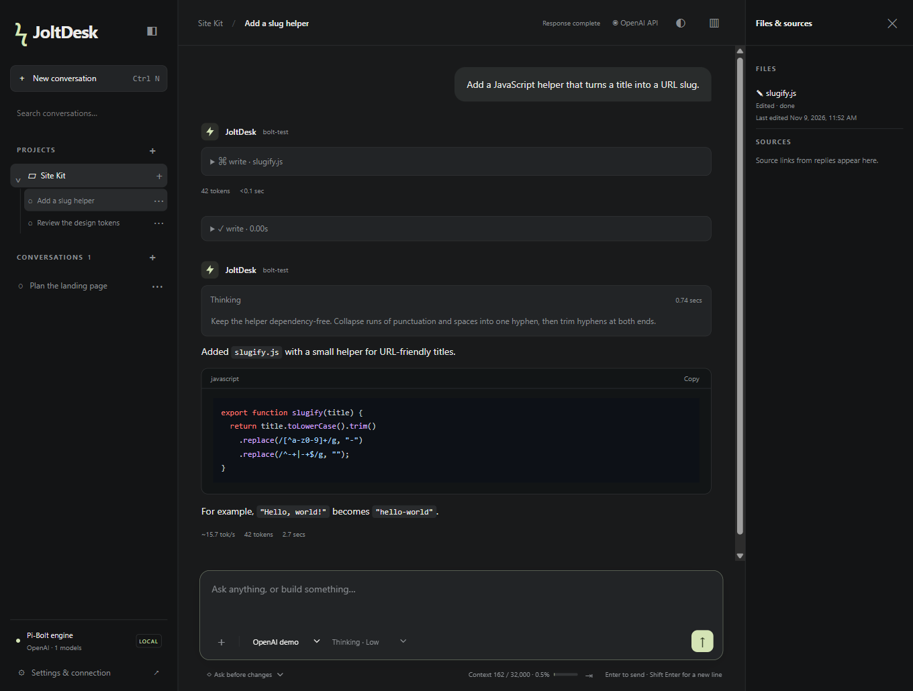
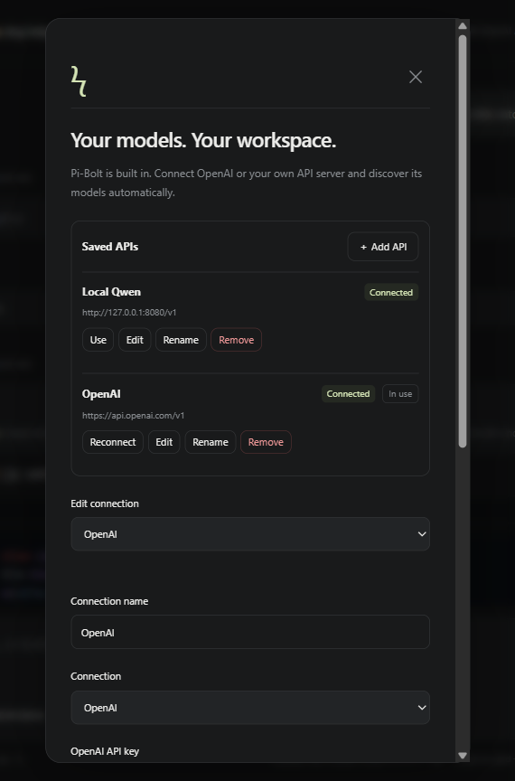

# JoltDesk

A standalone desktop GUI with **Pi-Bolt built in**, connected through its streaming RPC protocol. The interface takes inspiration from Claude Desktop, Codex, and llama.cpp's chat UI. This is an independent MVP, not an exact feature-for-feature clone.

## Run on Windows ARM64

1. Open **JoltDesk-0.14.0-win-arm64.exe** from the [Windows ARM64 release](https://github.com/nikunjsingh93/JoltDesk/releases/latest).
2. Open **Settings & connection**, select OpenAI or Local / OpenAI-compatible API, enter connection details, and click **Connect & discover models**.
3. Pick a model and start chatting. No manual `models.json` changes, terminal commands, or Node installation are needed for the portable build.

This delivery targets Windows ARM64 only. It contains its own engine and needs no existing Pi-Bolt installation.

If you pinned an earlier version and see a blank taskbar icon, unpin it, open the new executable from the folder where you plan to keep it, then pin the running app again.

## Screenshots

Screenshots use a demo workspace and simulated model connections.

### Chat workspace



### API connections



## Browser actions and context limits in 0.14

With **Web** on, the agent can work in the built-in browser. It reads a page as text plus numbered elements, clicks with `browser_click`, types with `browser_type` (optionally pressing Enter), presses keys, scrolls, and takes screenshots for models that accept images. The first click, typing, or key press in a chat asks for approval once, unless the chat uses Bypass. The agent cannot type into password fields. `browser_open` also opens local dev servers such as `http://localhost:3000`, and local files such as an HTML page it built when the chat has **Read files** or a higher permission. Other private network addresses stay blocked.

For Unsloth Studio, JoltDesk reads the loaded model's real context length from `/v1/status`, and checks again after replies. Image support for Unsloth models comes from its vision check and `/v1/status`, so vision models such as Qwen3-VL accept attached images. If a model cannot take images, JoltDesk says so before sending and keeps your message and attachment. When a server has not reported a model's limit, the context meter shows only the tokens used, with no guessed limit. While the agent edits a file, the tool panel shows the arguments as readable lines instead of one long JSON string.

## Offline APIs

A chat still opens when its API is offline or has been removed. You can read the whole conversation, and choosing a model from any working API in the model menu continues the same chat there. The status bar shows which API is offline.

## Skills in 0.13

A skill is a folder with a `SKILL.md` file that teaches the agent a specific task, using the open [Agent Skills](https://agentskills.io/specification) format. The agent sees each skill's name and description, and reads the full instructions only when a request matches. Type `/` in the message box to pick a skill, or type `/skill:name` followed by details to run one directly.

- **Personal skills** apply to every chat. Manage them in **Settings → Skills**: **＋ New skill** writes a starter `SKILL.md`, **Import folder…** copies a skill folder into JoltDesk, **Open folder** shows where they live, and each skill can be turned off or removed. Removed skills move to JoltDesk's trash folder.
- **Project skills** in a project's `.agents/skills`, `.claude/skills`, or `.pi/skills` folder are off until you choose **Use project skills** in the Files tab, because they can tell the agent to run scripts.
- The Files tab lists the skills a chat can use. Automatic use needs **Read files** or a higher permission. `/skill:name` works in every mode.

## Coding tools in 0.12

0.12 adds the Changes, Git, and Terminal tabs and instruction files, described below. To remove a project, open its **⋯** menu in the sidebar and choose **Remove project**. This removes the project and its chats from JoltDesk and archives the chats in JoltDesk's trash folder. The project folder and its files are not changed. A project cannot be removed while one of its chats is replying.

### Terminal tab and instructions

The side panel's **Terminal** tab runs commands in the chat's folder: PowerShell on Windows (PowerShell 7 when it is installed), or your shell elsewhere. Output streams live. **Stop**, or Ctrl+C in an empty command box, ends the command and everything it started. A running command has its own input box for answering prompts. `cd` changes the terminal's folder, ↑ and ↓ recall earlier commands, and **Clear** or Ctrl+L removes finished commands. Commands the agent runs with `bash` or `powershell` appear in the same list, marked ϟ, with live output. **Stop** on one of them stops the agent's reply. The terminal has no pseudo-terminal, so full-screen programs such as editors do not work there.

The agent follows instruction files. It reads `AGENTS.md`, or `CLAUDE.md` when a folder has no `AGENTS.md`, from the chat's folder and every folder above it. The Files tab lists the files a chat uses. Click one to open it, or use **＋ Create AGENTS.md** to start one in the chat's folder. **Settings → Personal instructions** apply to every chat. Changes take effect from each chat's next message.

### Git tab

The side panel's **Git** tab shows the Git repository for a project chat's folder: the branch, whether it is ahead of or behind its upstream, the changed files, and the most recent commits. Click a file to see its diff against the last commit. Tick the files to include, then write a message or click **✨ Write message** to have the chat's model write one from the selected changes. That request runs separately and does not appear in the conversation. **Commit** commits only the ticked files. **Push** sends commits to the upstream branch, and **Publish** pushes a new branch and sets its upstream. JoltDesk uses the `git` command on your PATH with your existing Git identity and credentials. Commits wait until the chat's reply finishes.

### Review and undo agent changes

The side panel has a **Changes** tab next to **Files** and **Browser**. Every request that edits files appears there with the files it changed and their added and removed line counts. Click a file to see a line diff.

**Undo** restores every file from that request to how it was before. If later requests changed the same files, those edits are undone too. **Revert** does the same for one file. JoltDesk asks first, and asks again if a file changed outside the agent after it was edited. The agent is told about the undo on your next message. Undo covers the `write` and `edit` tools. Files changed by `bash` or `powershell` commands are not tracked, and the request notes that commands ran. Files larger than 5 MB are listed but cannot be restored. Snapshots are stored with the app's data and move to the trash folder with a deleted chat.

## Built-in browser in 0.11

The right side panel now has **Files** and **Browser** tabs. Open it with the panel button in the header and choose **Browser** to browse in tabs with back, forward, reload and an address bar that also accepts searches. Links in replies and in Sources open there. Ctrl or Shift click opens your default browser instead. **＋ Chat** attaches the open page's text to your next message, and ↗ opens it in your default browser.

The browser keeps its own cookies and sign-ins in a separate JoltDesk profile. Pages run sandboxed without access to JoltDesk. Camera, microphone, location and notification requests are declined. When **Web** is on in a chat, the model can also use `browser_open` to open a public page in a new browser tab and read it after its scripts run, and `browser_read` to read the page you have open. Agent tabs are marked with ϟ. Only turn on Web when you are comfortable with the model reading the page you are viewing.

## Code scrolling, file actions and web access in 0.10.6

Streaming code holds your scroll position when you move up. Return to the bottom to follow new lines. The Files panel shows the last modification time from disk, and clicking or right-clicking a completed file opens its menu with **Open with…** and **Show in folder**.

Turn on **Web** beside the chat permissions to let the model search DuckDuckGo and read public pages. Sources appear in the right panel. Page browsing is read-only and extracts text and links from HTML without running page scripts. Web is off by default in each chat.

## Unsloth thinking controls in 0.10.4

Unsloth Studio Qwen3.8 now offers Off, Low, Medium and Extra high. Discovery uses explicit model/props effort metadata first; when Studio omits those fields, its documented Qwen3.8 template levels are used. An explicitly empty effort list keeps on/off only. Qwen3.6 keeps on/off and models without a thinking switch keep the control hidden.

Discovery checks props model_alias before using a template, context limit or vision capability: some routers return the resident model for every requested model. Its settings must not leak into unloaded models.

Selected efforts are sent both as the OpenAI-compatible reasoning_effort field and inside chat_template_kwargs, so llama.cpp-based Studio endpoints apply the selected template effort. Off disables thinking without passing an invalid none effort into the template. Splash effort detection and its separate token budget remain unchanged. Open Settings and reconnect/discover your Ubuntu API to refresh existing model lists.

## Splash thinking controls in 0.10.3

The thinking dropdown offers only distinct efforts supported by the connection. Current Splash model catalogs advertise them directly; older Splash versions are checked through their template-only endpoint without inference. Qwen3.8 offers Off, Low, Medium and Extra high. APIs that cannot demonstrate separate efforts keep their on/off controls. Unsupported thinking remains hidden.

In Settings, Edit a Splash API and set **Thinking token budget**, then **Save changes**. Blank uses the server default; a number such as 2048 caps thinking separately from the total output limit. Zero is preserved. The budget is scoped to that API and applies to future replies; saving does not interrupt a running reply. Effort controls how the template requests reasoning; it is not a token cap.

Conversation counts sit directly beside the Conversations title, with the + button at the far right.

## Thinking, vision discovery and resizing in 0.10.2

Thinking uses the same sanitized Markdown and syntax highlighting as replies, including unfinished streaming code fences, PowerShell and code copy buttons. Its spinner and elapsed time appear once, inside the thinking section; the header says Generating. Live thinking follows new content until you scroll up.

Drag the left edge of Files & sources to resize the right panel, or focus its divider and use arrow keys/Home/End. Width is bounded to preserve chat space and remembered in browser storage for the current app origin. Model discovery recognizes Splash vision/input_modalities metadata. Remove --language-only on the Splash server, restart it and reconnect/discover the API to enable supported image input. Vision needs additional memory and image processing time.

## API editing in 0.10.1

Clicking an API's **Edit** scrolls directly to its fields beneath the sticky close bar. Existing APIs have an explicit **Save changes** button; it saves the edited profile without selecting that API for your chat or restarting its running replies. New APIs use **Connect & save API**, and existing profiles retain a separate **Reconnect & discover models** action.

Each API keeps an in-memory draft while you switch between sections or close/reopen Settings. Unsaved edits are labeled. A blank output field is saved as Auto, and saved settings survive app restart. Draft API keys remain in memory only, never browser storage; successful saves clear the draft and the key input. Saving validates the endpoint/model settings; a failed save retains the draft and previous saved settings.

## Parallel chats, activity layout and output defaults in 0.10

Replies keep generating when you open or create another conversation, including on another API. Every chat owns its Pi-Bolt process, model registry and credential environment; identical model IDs and tool continuations stay bound to the right endpoint. Switching the model picker no longer closes other runners. Stop acts on the current chat only. Running chats show a spinner in the sidebar. Persistent per-chat streams preserve partial thinking, message history, drafts and attachments when switching; snapshot sequences restore live output after a UI reload without replaying duplicate deltas. Closing the application still closes its engine processes.

The **Conversations** header now has a **+** for a new general chat. Drag the sidebar's right edge to resize it, or focus the divider and use arrow keys. The right **Files & sources** panel shows tool-reported edited/read paths and links already present in chat messages. It does not read extra files, call a model or add anything to prompts. Toggle it from the header; it closes on narrow layouts.

The live spinner/status and elapsed timer now appear inside the assistant reply above its thinking area. The composer has no activity row above it. Thinking duration is tracked separately, survives returning to a background chat and remains beside the thinking section after completion. Durations use formats such as **1 min 36 secs**. Native provider token counters are used as soon as available, even before a useful speed sample; APIs without a live count still show an explicit estimate until authoritative usage arrives.

Blank local output limits now mean **Auto**, including migration of older blank profiles; the hidden 4096 fallback is removed. Explicit numeric limits remain fixed limits. Auto leaves the cap to the server, which may still impose its own default or context limit. A `length` finish during thinking now shows an **Output limit reached** notice instead of looking like a freeze; a server-imposed Auto cutoff is distinguished from an app numeric cap.

Validation covers two authenticated APIs generating simultaneously, an endpoint-bound file tool and continuation, cancelling one reply without stopping the other, UI reload during both streams, restored thinking, sidebar dragging, file/source inspection without prompt additions, and a simulated 4096-token thinking cutoff. No real long-running request is automatically restarted.

## Project trees and API availability in 0.9

The sidebar now shows expandable projects with their conversations nested underneath. Each project has its own **+** button for a new project chat. Nested chats retain their **⋯** Rename/Delete actions. Multiple projects can be expanded together; search includes their chat titles. The separate **Conversations** section contains only general chats without a project. The main **New conversation** button and Ctrl/Cmd+N create general chats. Sidebar navigation scrolls while Settings remains accessible at the bottom.

Saved APIs now have independent **Connected** badges, so all reachable, authenticated endpoints can show connected together. A separate **In use** badge marks the API selected for the current chat. Status checks query each endpoint's model catalog with its own key; they do not activate models, change the selected API, or send inference requests. Settings checks statuses when opened and every 30 seconds while open, with a 30-second cache. Unreachable endpoints and missing/rejected keys have distinct labels. Status is checked again after restart rather than trusting an old saved green badge.

## Saved APIs and Auto output in 0.8

Settings has a **Saved APIs** section with **Add API**, **Use**, **Edit**, **Rename**, and **Remove**. Adding another endpoint keeps existing profiles, limits, cached model lists, and encrypted keys. Removal is confirmed and affects only that endpoint; chat history is retained. The model picker groups models under your connection names and handles identical model IDs on different endpoints. Chats remember their selected connection and reopen it automatically; a removed connection must be replaced explicitly rather than silently sending to another API.

Legacy connections migrate automatically. Other endpoints with remembered encrypted credentials are recovered as additional profiles; their old per-endpoint overrides cannot be reconstructed if an older version overwrote that metadata, so edit those if needed. Recovered profiles discover their models when used. Keys stay scoped to the normalized endpoint and are never returned in config or written to workspace metadata. Failed discovery leaves the active endpoint unchanged.

**Auto output limit** omits the app's output-cap parameter so the server chooses its default within its remaining context. An explicit value such as **40000** remains available. From 0.10, blank numeric output also means Auto; earlier builds treated blank as 4096. Context discovery reads runtime metadata, per-model router properties and native context estimates. Runtime capacity wins over training/native maxima; unknown or native-only limits are marked estimated. Unknown context no longer falsely rejects a numeric output limit merely because of the app's 32768 fallback; the server still enforces its real capacity.

The context indicator updates immediately when changing APIs or models, including before the first chat.

## Generation speed in 0.7

The reply row now uses **server-reported generation tok/s**, matching llama.cpp/Splash `timings.predicted_per_second`. Prompt processing and initial waiting are excluded; generated thinking, answer and tool tokens are included. Pi-Bolt's raw provider-stream hook preserves the original numeric timing counters, and llama.cpp connections request per-token timings for live updates. No timing/content proxy is added.

When a server supplies timing only at completion, the live rate is an estimate until the authoritative timing arrives. APIs without native timing use an explicitly marked `~` estimate measured from the first streamed output token. Insufficient or buffered samples have no completed rate. Old saved replies with only request averages hide their speed; new decoder timings persist across app restarts. The separate duration remains total request time, with a tooltip explaining it.

Generation rates vary by model, workload and context.

## Chat and Settings controls in 0.6

Use the **⋯** button beside a conversation to open a small dropdown with **Rename** and **Delete**. Each opens its own dialog. The menu supports keyboard navigation, Escape, and outside-click dismissal. Deletion asks for confirmation, requires an idle chat, and archives conversation files under the app data directory's `trash` folder. A persistent deletion marker prevents old session recovery from restoring removed chats. Renaming preserves the conversation and messages.

Settings closes when clicking the backdrop, and its close button stays visible while scrolling. Clicking or selecting text inside Settings keeps it open.

Splash model discovery collapses a resident model’s canonical ID and its explicitly linked alias. Other models remain available.


## Streaming and metric corrections in 0.5

The request clock now starts before the HTTP inference request, rather than at the first received assistant event. Completed timing also uses Pi-Bolt's full provider duration. The reported 17,000+ tokens/sec bug came from dividing the completed token count by the few milliseconds needed to deliver a buffered batch. Existing saved replies are corrected on display using their provider duration; saved legacy rates are not trusted.

Version 0.5 labeled speed **tok/s avg** and included waiting and prompt evaluation. Version 0.7 replaces that measurement with the generation-speed behavior above. During generation, output counts marked **~** are text-length estimates until reported usage or native token counts arrive. Durations below 0.1s use `<0.1s` instead of rounding to `0.0s`.

Unknown local/compatible-API pricing no longer displays a manufactured `$0.0000`. Cost is hidden when no nonzero price or explicitly reported provider cost is available. Nonzero catalog-derived cost is labeled estimated; tiny nonzero costs are not rounded down to a false zero.

The UI creates a live reply placeholder as soon as inference starts, then switches from Processing to Thinking, Writing, or tool activity according to the incoming events. Text/thinking deltas render immediately in short UI batches. File-writing tool arguments also stream: generated HTML/code is decoded from incomplete JSON and displayed before the write tool executes.

Compatible API requests explicitly use streaming and request uncompressed event streams (`Accept-Encoding: identity`) to avoid additional compression buffering. This cannot force an upstream server or reverse proxy to flush data that it has not sent.

If direct API requests stream smoothly and requests through a reverse proxy arrive in batches, check the proxy’s buffering settings.

Example advanced settings for a streaming API in Nginx Proxy Manager:

```nginx
proxy_buffering off;
proxy_request_buffering off;
proxy_cache off;
gzip off;
proxy_read_timeout 3600s;
proxy_send_timeout 3600s;
```

These are proxy-host directives, not a replacement server/location block. Existing entries for the same directives should be updated rather than duplicated. The key response-streaming setting is `proxy_buffering off`; see [Nginx's proxy module documentation](https://nginx.org/en/docs/http/ngx_http_proxy_module.html#proxy_buffering).

Automated UI tests explicitly verify thinking and text while generation is still active, streamed tool code, and correct timing/rate when an entire response is released at once after a delay. The packaged app was also tested live through the repaired public proxy: it received 196 thinking/text delta events, displayed growing text before completion, and showed 17.3 seconds and 11.5 tokens/sec average with unknown cost hidden. These are one test's measurements, not a throughput guarantee. Diagnostics include response content type/encoding, request duration, first-delta timing, and event counts without logging keys or response text.

## Chat and permission fixes in 0.4

- User messages align right and occupy at most 68% of the conversation width on desktop; assistant replies keep their full available width.
- The reply logo uses an SVG constrained inside its avatar box.
- The bottom status bar is removed. Context use and the compaction button sit immediately left of the Enter-to-send hint; overall status sits in the top header.
- Each assistant reply has its own tokens/sec, token count, duration, and cost row. It updates live and remains attached to that reply afterward, including when reopening a chat.
- Streaming thinking opens automatically and follows the newest text inside the thinking panel. Scrolling up lets you inspect earlier thinking without the panel forcing you back down during the stream.
- Thinking controls are hidden for models with no supported thinking levels. Models marked capable by server/model metadata or the connection's Enabled override expose their supported controls; the Qwen connection offers Thinking on/off.
- The waiting indicator says **Waiting for model** rather than **Connecting to model** for each generation. Completed replies stop the activity indicator.
- Permissions apply to the running engine, without restarting the conversation. An upgrade during generation is steered into the next model step with current tool declarations. Pending approvals are resolved according to the newly selected mode. Already-running commands cannot be retroactively undone.
- The model request's tool section is kept consistent with the current permission mode, even when history contains an earlier no-tools session. Tool executions remain gated by the current policy.
- A single-instance guard prevents multiple new-version windows from writing the same chat index independently. Saved session logs missing from the index are recovered on startup; recovered conversations default to Ask before changes because their prior permission setting cannot be reliably inferred. Select Bypass again if that is the mode you want.

The reported HTML conversation's log initially contained no active tools. Later it recorded newly enabled tools, but Qwen still referred to its earlier no-tools context; it contained no actual filesystem access-denied tool result. The regression test copied that conversation into an isolated profile, switched to Bypass while Qwen was generating, and verified a real HTML file write inside the test workspace. It did not write into Downloads during testing.

App diagnostics now record permission transitions, active/declared tool names, and reply timing under `diagnostics.jsonl` in the app data directory. These diagnostics exclude API keys, prompts, and file contents. Pi session logs continue to retain normal conversation/tool history.

Pi-Bolt 1.1.4 and its complete release resources and license notices are bundled in this build. There is no separate Pi-Bolt, Node.js, or Bun installation to perform, and no terminal to leave open. Copy the executable to another compatible Windows ARM64 PC, open it, and enter a key there. The app starts and stops its own engine in the background. It does not depend on or modify a separate Pi-Bolt installation. The current Windows engine is the upstream x64 build, running through Windows 11 x64 emulation on ARM64.

## Local Qwen and other compatible APIs

In **Settings & connection**, select **Local / OpenAI-compatible API**. Paste the API **Base URL** and **API key**. For llama.cpp, select the **llama.cpp / Qwen** compatibility profile. An unauthenticated server can use an empty key. A bare server/web UI URL is normalized to `/v1`; a URL already ending in `/v1` is kept.

**Context window** and **Max output tokens** are editable. Leave context blank for automatic discovery, and leave output blank to use the server’s default. These settings do not resize the server’s KV cache.

Click **Connect & discover models**, then choose the model exposed by that API. The selected model is remembered separately for each connection and used for new chats. The app generates its internal provider configuration automatically; no manual `models.json` editing is needed. The model list comes from `/v1/models`, while generation uses `/v1/chat/completions`.

On desktop, the app can save a connection key in the operating system’s encrypted store. Enter your own connection details when setting up a new installation.

Thinking capability can be set to **Auto-detect**, **Enabled**, or **Disabled**. Available controls depend on the model and server. See [llama.cpp’s server API](https://github.com/ggml-org/llama.cpp/blob/master/tools/server/README.md).

Keep your inference server running and use a reachable API URL. The bundled Pi-Bolt engine supplies the agent runtime. Model weights and inference are managed by the connected server.

Keys are scoped to each exact API base URL. Desktop mode can remember keys in the OS-encrypted store. Browser mode keeps keys in backend memory. The model picker groups models by saved connection.

## Engine updates

Automatic **stable-release checks** are on by default: shortly after startup and every six hours while the app is open. Settings shows the installed engine version, update status, a manual **Check for updates** button, and a switch to turn automatic checks off. When a newer release appears, choose **Install update** in Settings. Downloads and installation are user-triggered, not silent background replacements. The GUI itself is not auto-updated by this engine updater.

The updater downloads from the official `opensec-git/Pi-Bolt` GitHub release, verifies the Ed25519 signature of `SHA256SUMS` using the upstream release key pinned in the app, and then verifies the archive SHA-256. It extracts to a separate staging folder, starts the candidate engine to check RPC compatibility, and activates it only after those checks pass. Busy chats block installation. Failed checks or downloads keep the current engine. On the next launch, a damaged managed update falls back to the bundled engine. No administrator rights or PATH edits are needed.

Managed updates live under `managed-engine` in the app's per-user data directory; the engine shipped inside the app stays intact as a fallback. Offline startup works with the bundled or previously installed engine. Remote model calls and checking/downloading updates need network access. Checks run while the app is open; there is no always-running service after you quit it.

## Included

- Project folders and saved chats in a left sidebar, with conversation search.
- OpenAI key verification and automatic discovery of models supported by both the account and the bundled/managed Pi-Bolt catalog.
- Local/OpenAI-compatible API URLs, optional keys, automatic model discovery, editable context/output limits, and per-connection preferred models.
- Bundled engine, automatic stable-update checks, signed downloads, and in-app engine installation.
- Per-chat model and supported thinking-level controls.
- Streaming Markdown, highlighted code with Copy buttons, and collapsible reasoning summaries.
- Tool activity cards with live output, result status, and execution duration.
- Live output-token estimates, response-average tokens/second, elapsed time, context use, and Pi-Bolt's reported session cost.
- Four enforced tool modes: **Chat only**, **Read files**, **Ask before changes**, and **Bypass approvals**.
- Text/source-code attachments, supported images, clipboard images, and drag-and-drop (8 MB per file).
- Context compaction, stop response, light/dark themes, and a responsive narrow layout.
- Native project-folder picker in the desktop build.
- Operating-system-encrypted key storage where a secure key store is available. Browser mode keeps the key in process memory only.

## Understanding thinking and usage

OpenAI does not expose private internal reasoning. Bolt renders the reasoning summaries or thinking text Pi-Bolt receives from the selected provider; some models or accounts may not provide them. An empty thinking panel is not replaced with invented content. See [official OpenAI reasoning documentation](https://developers.openai.com/api/docs/guides/reasoning).

Many hosted APIs report token usage only when a response completes. During that interval, values marked **~** are rough text-length estimates (about four characters per token), including exposed reasoning text and generated tool arguments. Hidden reasoning tokens cannot be counted live. Provider usage replaces estimates when available. Tokens/second is request-average throughput including waiting/thinking time, not isolated decoder throughput. Context values use Pi-Bolt's estimate between turns and a live estimate while streaming. Catalog-derived costs are labeled estimates, not an invoice; unknown local pricing is hidden.

## Permissions and data

Chat only disables all tools. Read files permits `read`, `grep`, `find`, and `ls`. Ask before changes adds editing and command tools, with a GUI approval before each `write`, `edit`, `bash`, or `powershell` call. Declining blocks the call. Bypass enables those tools without approval, including command execution.

Tool modes are not operating-system sandboxes. Read tools can access paths the agent process can read; approved commands and bypass commands run with your user account's permissions. Files are sent to your selected model API when attached or read by the agent as part of a prompt. The frontend and backend listen only on loopback. An API on localhost can work offline; a remote API needs network access.

Desktop settings, encrypted credentials, and session files are stored in Electron's per-user application-data directory for `joltdesk`. Upgrades reuse an existing Bolt Desktop profile in place. Browser mode stores non-secret state in `.bolt-data` beside the source. Keys are passed to Pi-Bolt through its environment rather than command-line arguments. Your existing `~/.pi/agent` configuration is not changed. Automatically loaded Pi extensions, skills, prompt templates, and MCP servers are disabled for this isolated MVP; only the app-owned permission policy extension is explicitly loaded. Its registered built-in tools are selectively enabled according to the current mode.

## Run or develop from source

Source development requires Node.js 22.19+. On Windows, double-click **Start JoltDesk.cmd**. On macOS/Linux, run `sh start.sh`. The launchers install npm dependencies if necessary; the first source launch downloads and verifies the appropriate engine automatically. A separate Pi-Bolt installation is not required.

```sh
npm install
npm start
```

For a local browser UI: `npm run web`, then open `http://127.0.0.1:4317`.

```sh
npm run build:ui       # regenerate the offline syntax-highlighter bundle
npm run bundle:engine  # download and verify the latest engine for this build platform
npm test              # real Pi-Bolt + local simulated Responses API integration
node test/cache-update-fixtures.mjs # optional: cache official signed assets for Windows update tests
node test/ui-check.mjs # desktop UI tests; uses a simulated model, no API key or paid calls
node test/chat-refinements-check.mjs # thinking follow, reply metrics, layout and switching to bypass mid-generation
node test/live-stream-ui-check.mjs # text before completion, streamed tool code and a buffered-response clock regression
node test/packaged-check.mjs # packaged Windows test with external Pi-Bolt disabled
node test/updater-ui-check.mjs # full update-button test using cached signed release fixtures
npm run portable      # build Windows portable executable on a Windows build machine
npm run dist          # build an unpacked app for the host platform
```

The bundled/managed engine is selected by default. Advanced engine settings allow a custom executable; **Use built-in engine** restores managed selection. Custom engines are not updated by the app. In a source checkout without an engine bundle, direct `node server.mjs` can still fall back to `PI_BOLT_PATH` or the installed Pi-Bolt; normal `npm start`/`npm run web` provision the bundle automatically. Browser mode supports `PORT` and `BOLT_DATA_DIR`. Build provisioning supports `BOLT_BUILD_PLATFORM` and `BOLT_BUILD_ARCH`; generate a matching engine bundle before building each platform.

## Validation and platform status

The Windows ARM64 build was tested with the bundled Windows x64 engine. Validation covered streaming, file approvals, managed engine update checks, session recovery, local API access, highlighting, and narrow layouts.

Update tests used the actual signed official release archive. They verified signature and checksum rejection, compatibility-failure recovery, successful engine activation, automatic-check preference persistence, offline recovery, and fallback after a damaged managed binary. The signed archive test is skipped on non-Windows hosts or when the optional cached fixtures are absent; use the cache command above to enable it on Windows.

Transport tests use local simulated endpoints with fixture credentials. They cover discovery, explicit limits, reasoning and text streaming, approvals, preferred models, reconnects, and credential isolation.

The delivered build targets Windows ARM64. The source retains platform support for future Windows x64, Apple-silicon macOS, and glibc-based Linux x64/ARM64 builds; those builds are outside this delivery. macOS and Linux installers need native builds and testing with their matching bundled engine. Upstream Pi-Bolt does not currently publish Intel Mac builds. Android packaging is not implemented. The responsive web frontend provides a starting point; an Android app needs a mobile transport to a running agent backend.

Electron was chosen to deliver an immediately runnable MVP without a Rust toolchain. A Tauri shell can reduce the desktop runtime footprint later, but needs a Rust backend or packaged sidecar to retain the same agent and credential behavior.

Not implemented yet: PDF/Office extraction, model-server/weights management, silent engine auto-installation, GUI application self-updates, chat branching and export, Git diff review, desktop signing, or cloud/mobile synchronization. New official OpenAI models absent from the engine's catalog require an engine update; compatible local API models are discovered and registered automatically.

Pi-Bolt protocol reference: [integrations](https://pi-bolt.opensec.in/docs/integrations.html), [RPC](https://pi.dev/docs/latest/rpc).

## Optional live API check

Set `BOLT_TEST_BASE_URL` to a test server and run `node test/live-api-check.mjs`. For an authenticated server, supply `BOLT_TEST_API_KEY` in the process environment. The check queries model and capability metadata without generating a reply. Test runs and screenshots are stored under the ignored `work/` directory.

## License

The desktop app is [MIT licensed](LICENSE). The bundled engine is [Pi-Bolt](https://github.com/opensec-git/Pi-Bolt). The distribution keeps the engine’s own license files and third-party notices with its resources. The [Pi-Bolt 1.1.4 notices](licenses/pi-bolt/THIRD_PARTY_NOTICES.md) are also included here, with their corresponding files in the [upstream release source](https://github.com/opensec-git/Pi-Bolt/tree/bolt-v1.1.4). The generated syntax-highlighter bundle is distributed with [Highlight.js’s license](licenses/highlight.js.txt).
